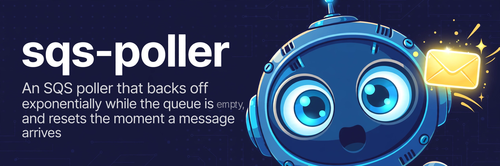

<p align="center">
  
</p>

<p align="center"><strong>Exponential backoff for idle SQS queues</strong></p>

<p align="center">
  <a href="https://crates.io/crates/sqs-poller"></a>
  <a href="https://github.com/conao3/rust-sqs-poller/actions/workflows/ci.yml"></a>
  <a href="LICENSE"></a>
  <a href="Cargo.toml"></a>
  <a href="https://github.com/conao3/rust-sqs-poller/stargazers"></a>
</p>

<p align="center">
  <a href="#why">Why</a> ·
  <a href="#cli">CLI</a> ·
  <a href="#tuning">Tuning</a> ·
  <a href="#library">Library</a> ·
  <a href="#cost-notes">Cost notes</a> ·
  <a href="https://crates.io/crates/sqs-poller">crates.io</a> ·
  <a href="https://docs.rs/sqs-poller">docs.rs</a>
</p>

# sqs-poller

An SQS poller that backs off exponentially while the queue is empty, and resets the moment a message arrives.

## Why

Long polling does not make an idle queue cheap. A 20 second long poll still adds up to about 4,320 empty receives a day for one queue and one consumer, and the count grows with each consumer you run. Most SQS consumers either long poll in a tight loop like that, wait a fixed interval, or back off only on errors.

sqs-poller sleeps between polls instead:

1. Poll the queue (long poll, 20 s by default).
2. Got messages: hand them over one at a time, delete each one the handler accepts, and poll again right away.
3. Got nothing: sleep, then double the sleep (1 s, 2 s, 4 s, ...) up to a cap of 300 s, and keep it there while the queue stays empty.
4. A message arrives: the sleep resets to 1 s.

An idle queue costs about 290 receives a day at the defaults instead of 4,320. A busy queue skips the backoff: a non-empty receive resets it, and the next poll runs at once.

## CLI

```console
$ cargo install sqs-poller
$ sqs-poller --queue-url https://sqs.ap-northeast-1.amazonaws.com/123456789012/jobs
```

Each message goes to one sink. A message is deleted only when its sink accepts it:

- **Standard output (default).** Prints one JSON line per message with `messageId`, `body`, and `attributes`. Handy for pipes and for draining a queue into a file.
- **HTTP endpoint.** `sqs-poller --queue-url <url> --endpoint http://127.0.0.1:8080/work` POSTs each message body, with an `x-sqs-message-id` header. A 2xx answer deletes the message, anything else leaves it for redelivery. This is the sqsd shape, without the daemon having to run on Elastic Beanstalk.
- **Command.** `sqs-poller --queue-url <url> --command ./handle.sh` runs the command once per message, with the body on stdin and the message ID in `$SQS_MESSAGE_ID`. Exit status 0 deletes the message.

A message a sink rejects stays in the queue. The visibility timeout makes it available again, and the queue's redrive policy sends it to the dead-letter queue after the configured number of attempts. Nothing about that is specific to this tool, so your existing DLQ setup keeps working.

AWS credentials and region come from the standard SDK chain (environment, shared config, IAM role, and so on). `--region` and `--profile` override them. Ctrl-C and SIGTERM trigger a graceful shutdown, and the poller prints the run's counters to stderr.

### Tuning

| Flag | Default | What it does |
| --- | --- | --- |
| `--min-interval-secs` | 1 | Sleep after the first empty poll, and the reset value |
| `--max-interval-secs` | 300 | Longest sleep between polls |
| `--multiplier` | 2.0 | Growth factor per empty poll |
| `--wait-time-seconds` | 20 | `WaitTimeSeconds` of each receive |
| `--max-messages` | 10 | `MaxNumberOfMessages` of each receive |
| `--no-jitter` | off | Sleeps are jittered by default (equal jitter), so pollers sharing a queue do not wake up in lockstep |

The queue URL can also come from the `SQS_POLLER_QUEUE_URL` environment variable.

## Library

```rust
use sqs_poller::{run, Config};
use tokio_util::sync::CancellationToken;

let aws = aws_config::load_defaults(aws_config::BehaviorVersion::latest()).await;
let client = aws_sdk_sqs::Client::new(&aws);
let config = Config::new(queue_url);
let stats = run(config, client, |message| async move {
    // Return Ok(()) to delete the message, Err to leave it for redelivery.
    process(message.body.as_deref().unwrap_or_default()).await
}, CancellationToken::new()).await;
```

The handler runs one message at a time, in receive order. `run` returns the counters (`received`, `deleted`, `failed`, `empty_polls`, `receive_errors`) once the cancellation token fires. Receive and delete errors are retried with the same backoff and reported through the optional `Config::on_error` callback.

The backoff itself is a small pure type, [`Backoff`](https://docs.rs/sqs-poller/latest/sqs_poller/struct.Backoff.html), if you want the sleep math inside your own receive loop.

## Cost notes

SQS charges per request, and a receive call costs the same whether it returns 0 messages or 10. The backoff cuts the idle cost by about 93% at the defaults. It does not change what a busy queue costs, and it should not: when messages flow, you want them drained fast.

One trade-off to know about: a message that lands in an idle queue waits for the current sleep to end before it is picked up, on top of the long poll wait. At the 300 s cap that is up to 5 minutes of pickup latency. Lower `--max-interval-secs` if your queue is latency sensitive and sits idle most of the time.

## License

Apache-2.0. See [LICENSE](LICENSE).
